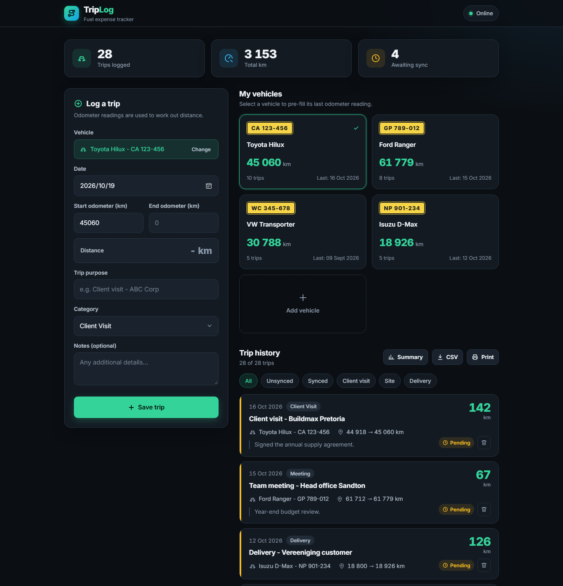
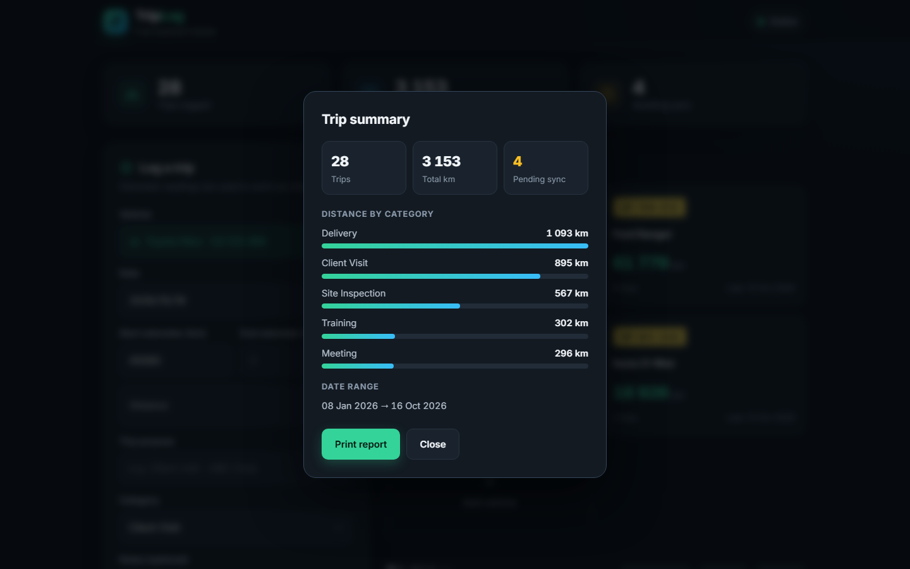
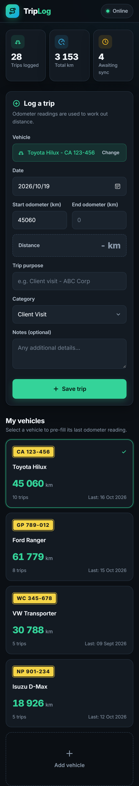

# TripLog

An offline-first trip and odometer logger for tracking business mileage and fuel expenses. It is a single HTML file with no build step, no dependencies and no backend. Your data stays in your browser.



## Features

- **Quick trip logging** with date, vehicle, start and end odometer, purpose, category and notes
- **Automatic distance** calculated from the odometer readings
- **Vehicle garage** with number plate cards, last odometer reading, trip count and last trip date
- **Smart odometer pre-fill**: pick a vehicle and the start reading is filled in from its last trip
- **Vehicle autocomplete** that remembers the vehicles you have used
- **Trip history** with filters for sync status and category
- **Sync status** indicator showing online or offline state, with a simulated sync for pending trips
- **Summary report** with totals, distance by category and date range
- **Export** to CSV or a print-friendly report
- **Responsive layout** that works on desktop, tablet and phone

## Screenshots

### Trip summary



### Mobile



## Getting started

No installation is needed.

1. Clone the repository:
   ```bash
   git clone https://github.com/MrPettitt/TripLog-WebApp.git
   cd TripLog-WebApp
   ```
2. Open `index.html` in any modern browser.

To serve it locally instead:

```bash
python -m http.server 8080
```

Then visit <http://localhost:8080>.

## How it works

- Trips and vehicles are saved to `localStorage`, so they persist between visits and work offline. If the browser blocks storage, the app still runs but data is kept in memory only.
- The first time the app loads it is seeded with sample vehicles and trips so you can explore it. Delete them from the trip history, or clear the site data in your browser, to start fresh.
- The sync button is a front-end simulation. It marks pending trips as synced and is the place to plug in a real API.

## Project structure

```
TripLog-WebApp/
├── index.html            # The whole app (HTML, CSS and JavaScript)
├── docs/screenshots/     # Images used in this README
├── LICENSE
└── README.md
```

## Tech

Plain HTML, CSS and vanilla JavaScript. The [Inter](https://rsms.me/inter/) typeface is loaded from Google Fonts, and the page falls back to the system font if it is unavailable.

## Roadmap ideas

- Real backend sync
- Edit existing trips
- Per-vehicle fuel cost and efficiency
- Date range filtering and PDF export

## License

Released under the [MIT License](LICENSE).
